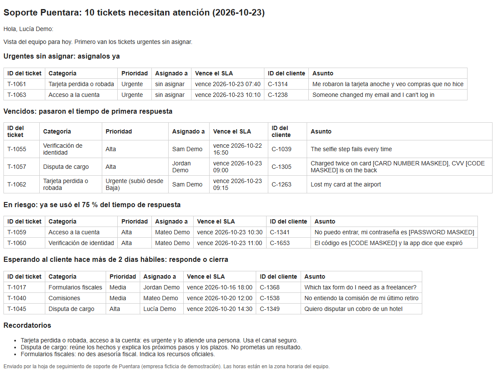

# Bilingual SLA Tracker for Google Sheets (EN/ES)

A Google Sheets support tracker that shows which tickets are about to miss their first-response time, and emails each agent and the team lead a short daily list in English or Spanish.

In one line: for small support teams that run their tickets from a spreadsheet and keep missing follow-ups.

> **Demo scenario.** Puentara is a fictional money app for freelancers and small businesses in the US and Latin America. All tickets, customers and agents are synthetic. The tracker itself uses no AI: every rule is plain JavaScript you can read.

## Why I built this

In support, the ticket that hurts is rarely the hard one. It's the easy one nobody looked at: a stolen card with no owner since early morning, or a customer marked "waiting on customer" that nobody followed up for a week. I spent about three years in bilingual customer support for banking and financial services, and plenty of small teams start out running their queue from a spreadsheet.

This tracker does the date math a lead would otherwise do in their head every morning, keeps sensitive categories from being marked low, and tells each agent what needs attention, in their own language.

What it doesn't do yet: it has no holiday calendar or multiple time zones, it isn't connected to a helpdesk, and the daily trigger hasn't been tested in a live sheet.

## The problem

A small team tracks support in a Google Sheet. It works until it gets busy. Nobody sees that a lost-card ticket has been sitting unassigned since 6:40 in the morning. A customer marked "Waiting on customer" never hears back. Someone marks a stolen card as "Low". The lead finds out when the customer writes again, angrier, and the Spanish-speaking agents get alerts written for someone else.

## What it does

- **First-response SLA status for every ticket:** OK, At risk (75% of the time used), Breached, and, once answered, Met or Missed.
- **Targets by priority:** Urgent 1 hour, around the clock (nights and weekends count). High 4, Normal 8 and Low 16 business hours, Monday to Friday 08:00 to 18:00. A ticket created Friday at 17:30 with 4 business hours is due Monday at 11:30.
- **Category priority floors.** Anyone can raise a priority, nobody can set it below the floor. A lost or stolen card is always Urgent; disputes, account access, identity checks and failed transfers are at least High. An empty Priority cell gets the category default.
- **Stale follow-ups:** a ticket "Waiting on customer" for more than 2 business days is flagged "follow up or close".
- **Daily digests in each person's language.** Each agent gets their own tickets. Each lead gets the team view, with unassigned urgent tickets first. Plain text and HTML. Recipients come only from the Agents tab, never from a ticket row.
- **Masking.** Card numbers, CVVs, one-time codes and labeled passwords that customers typed into a subject are hidden before anything goes into a digest.
- **No same-day repeats.** A ticket already in today's digest is skipped on the next run, except unassigned urgent tickets: those are alerted on every run until someone owns them.
- **Fixed reminders** in the digest for sensitive categories: lost cards and account access go to a person, disputes get no promised outcome, tax questions get no tax advice.
- **Weekly summary tab:** tickets opened, first responses met and missed, open now and stale follow-ups, by category and by language.
- **English or Spanish sheet.** Column headers work in either language, the menu and tabs follow the sheet's language, and an empty Language cell is filled by a simple word-count detector.
- **Safe by default.** `DRY_RUN` is on: digests go to a "Digest preview" tab and nothing is emailed until you turn it off.
- **A local demo with no Google account**, running the same functions on CSV files.

## 60-second demo

You need **Node.js 22.12 or newer** (only needed for the tests and the local demo; the Apps Script file doesn't need Node). No API key and no Google account needed.

The commands are the same in PowerShell and bash:

```
git clone https://github.com/RawBud11/bilingual-sla-tracker.git
cd bilingual-sla-tracker
npm install
npm test
npm run demo
npm run demo -- --lang es
```

On the Windows 11 build machine, a clean `npm install`, `npm test` and `npm run demo` took under 10 seconds in total, with npm's download cache already filled (2026-10-24). A first install on a new machine downloads about 50 small packages and can take longer.

The demo uses a fixed clock, **Friday 2026-10-23 10:00**, so the output always matches the sample data. Other options:

```
npm run demo -- --now "2026-10-26 09:00"
npm run demo -- --out my-folder
```

`npm run make-data` rebuilds the sample data from a fixed seed (same seed, same files).

### PowerShell 5.1 and accents

The console shows accents correctly. But Windows PowerShell 5.1 garbles them (SIMULACI├ôN instead of SIMULACIÓN) when you **pipe or redirect** the Spanish demo, for example into `Out-File` or `Select-String`. Run this first in the same window:

```powershell
[Console]::OutputEncoding = [Text.UTF8Encoding]::new()
```

### Troubleshooting

- **npm warns that it skipped esbuild's install script.** That's fine: vitest still runs.
- **Excel shows accents wrong in the output CSVs.** The files are UTF-8 without a BOM. Google Sheets reads them fine; in Excel, import them as UTF-8.

## Example output

Real output captured on 2026-10-24 (Windows 11, Node.js 24.21.0, npm 11.19.0). All counts are **sample data**. The full capture is in `docs/demo_output.txt`.

### `npm run demo`

```
DRY RUN: nothing is emailed. Puentara is a fictional company and all data is synthetic.
Clock: 2026-10-23 10:00 (team time zone)

Open tickets, most urgent first
Ticket ID  Category               Priority                  Assignee     SLA due           SLA status
T-1061     Card lost or stolen    Urgent                    unassigned   2026-10-23 07:40  Breached
T-1063     Account access         Urgent                    unassigned   2026-10-23 10:10  At risk
T-1052     General question       Low                       Jordan Demo  2026-10-22 15:00  Breached, already alerted today
T-1055     Identity verification  High                      Sam Demo     2026-10-22 16:50  Breached
T-1057     Charge dispute         High                      Jordan Demo  2026-10-23 09:00  Breached
T-1062     Card lost or stolen    Urgent (raised from Low)  Sam Demo     2026-10-23 09:15  Breached
T-1059     Account access         High                      Mateo Demo   2026-10-23 10:30  At risk
T-1060     Identity verification  High                      Mateo Demo   2026-10-23 11:00  At risk
T-1017     Tax forms              Normal                    Jordan Demo  2026-10-16 18:00  Met, follow up or close
T-1040     Fees                   Normal                    Mateo Demo   2026-10-20 12:00  Met, follow up or close
T-1045     Charge dispute         High                      Lucía Demo   2026-10-20 14:30  Met, follow up or close
T-1001     Card lost or stolen    Urgent                    Sam Demo     2026-10-12 11:10  Met
T-1002     Fees                   Normal                    Jordan Demo  2026-10-13 09:35  Met
T-1006     Fees                   Normal                    Mateo Demo   2026-10-14 13:00  Met
T-1013     Card lost or stolen    Urgent                    Sam Demo     2026-10-15 16:05  Met
T-1021     App bug                Normal                    Lucía Demo   2026-10-19 14:25  Met
T-1039     Card lost or stolen    Urgent                    Lucía Demo   2026-10-19 15:00  Met
T-1030     Tax forms              Normal                    Sam Demo     2026-10-19 16:00  Met
T-1031     App bug                Normal                    Sam Demo     2026-10-19 16:00  Met
T-1048     Charge dispute         High                      Sam Demo     2026-10-21 10:00  Met
T-1051     App bug                Normal                    Sam Demo     2026-10-21 17:00  Met
T-1058     General question       Normal                    unassigned   2026-10-23 14:05  OK

Breached: 5   At risk: 3   Stale follow-ups: 3   Unassigned urgent: 2
1 ticket had its priority raised to the category minimum.
4 digests written to output/ (DRY RUN, nothing emailed)

Weekly summary (sample data)
Weekly summary, 2026-10-16 10:00 to 2026-10-23 10:00 (sample data)
Group    Opened  First response met  First response missed  Open now  Stale follow-ups
English  29      21                  3                      16        1
Spanish  18      12                  2                      6         2
Mixed    0       0                   0                      0         0
Other    0       0                   0                      0         0
Total    47      33                  5                      22        3

Files written:
  output/tracker_checked.csv
  output/digest_lead_es.txt
  output/digest_mateo_demo_es.txt
  output/digest_sam_demo_en.txt
  output/digest_jordan_demo_en.txt
  output/digest_lead_en.txt
  output/digest_es.html
  output/weekly_summary.csv
```

A few things to notice:

- **T-1062** was typed as Low. It's a lost card, so the floor raised it to Urgent, and with a 1-hour clock it's already breached.
- **T-1052** is breached, but it was already in a digest at 07:30 today, so it isn't repeated.
- **T-1061**, a stolen card with no owner, was also alerted at 07:30. It's in the digest again because unassigned urgent tickets are alerted on every run.

### `npm run demo -- --lang es` (first lines and the summary)

```
SIMULACIÓN: no se envía ningún correo. Puentara es una empresa ficticia y todos los datos son sintéticos.
Reloj: 2026-10-23 10:00 (zona horaria del equipo)

Tickets pendientes, los más urgentes primero
ID del ticket  Categoría                  Prioridad                   Asignado a   Vence el SLA      Estado del SLA
T-1061         Tarjeta perdida o robada   Urgente                     sin asignar  2026-10-23 07:40  Vencido
T-1063         Acceso a la cuenta         Urgente                     sin asignar  2026-10-23 10:10  En riesgo
T-1052         Pregunta general           Baja                        Jordan Demo  2026-10-22 15:00  Vencido, ya se avisó hoy
T-1055         Verificación de identidad  Alta                        Sam Demo     2026-10-22 16:50  Vencido
T-1057         Disputa de cargo           Alta                        Jordan Demo  2026-10-23 09:00  Vencido
T-1062         Tarjeta perdida o robada   Urgente (subió desde Baja)  Sam Demo     2026-10-23 09:15  Vencido
T-1059         Acceso a la cuenta         Alta                        Mateo Demo   2026-10-23 10:30  En riesgo
T-1060         Verificación de identidad  Alta                        Mateo Demo   2026-10-23 11:00  En riesgo
T-1017         Formularios fiscales       Media                       Jordan Demo  2026-10-16 18:00  Cumplido, responde o cierra
...

Vencidos: 5   En riesgo: 3   Seguimientos atrasados: 3   Urgentes sin asignar: 2
A 1 ticket se le subió la prioridad al mínimo de su categoría.
4 resúmenes guardados en output/ (SIMULACIÓN, no se envió ningún correo)

Resumen semanal (datos de muestra)
Resumen semanal, del 2026-10-16 10:00 al 2026-10-23 10:00 (datos de muestra)
Grupo          Recibidos  Primera respuesta a tiempo  Primera respuesta tarde  Pendientes ahora  Seguimientos atrasados
Inglés         29         21                          3                        16                1
Español        18         12                          2                        6                 2
Mixto          0          0                           0                        0                 0
Otro           0          0                           0                        0                 0
Total general  47         33                          5                        22                3
```

### An agent's digest in Spanish (`output/digest_mateo_demo_es.txt`)

Mateo's language on the Agents tab is Spanish, so his digest is in Spanish. The card code and password the customers typed are masked.

```
To: mateo.demo@example.com
Subject: Soporte Puentara: 3 tickets necesitan atención (2026-10-23)

Hola, Mateo Demo:

Tienes 3 tickets que necesitan atención hoy.

En riesgo: ya se usó el 75 % del tiempo de respuesta
- T-1059 | Acceso a la cuenta | Alta | Mateo Demo | vence 2026-10-23 10:30 | C-1341
  "No puedo entrar, mi contraseña es [PASSWORD MASKED]"
- T-1060 | Verificación de identidad | Alta | Mateo Demo | vence 2026-10-23 11:00 | C-1653
  "El código es [CODE MASKED] y la app dice que expiró"

Esperando al cliente hace más de 2 días hábiles: responde o cierra
- T-1040 | Comisiones | Media | Mateo Demo | vence 2026-10-20 12:00 | C-1538
  "No entiendo la comisión de mi último retiro"

Recordatorios
- Tarjeta perdida o robada, acceso a la cuenta: es urgente y lo atiende una persona. Usa el canal seguro.

Enviado por la hoja de seguimiento de soporte de Puentara (empresa ficticia de demostración). Las horas están en la zona horaria del equipo.
```

### An agent's digest in English (`output/digest_jordan_demo_en.txt`)

```
To: jordan.demo@example.com
Subject: Puentara support: 2 tickets need attention (2026-10-23)

Hi Jordan Demo,

You have 2 tickets that need attention today.

Breached: past the first-response target
- T-1057 | Charge dispute | High | Jordan Demo | due 2026-10-23 09:00 | C-1305
  "Charged twice on card [CARD NUMBER MASKED], CVV [CODE MASKED] is on the back"

Waiting on customer for over 2 business days: follow up or close
- T-1017 | Tax forms | Normal | Jordan Demo | due 2026-10-16 18:00 | C-1368
  "Which tax form do I need as a freelancer?"

Reminders
- Charge dispute: collect the facts, explain next steps and timeline. Don't promise an outcome.
- Tax forms: no tax advice. Point to official resources.

Sent by the Puentara support tracker (fictional demo company). Times are in the team time zone.
```

## Screenshots



The lead's digest in Spanish (`output/digest_es.html`, opened in a browser). Unassigned urgent tickets come first. This is the HTML body an email would carry; it was rendered locally, not sent through Gmail.

## Use it in your own Sheet

**Tried once in a real Google Sheet** on 2026-10-24, following these steps with an English sheet, 11 synthetic tickets and 4 synthetic agents whose addresses were aliases of my own Gmail. See [Real Sheet test](#real-sheet-test-2026-10-24) for what was checked. The daily trigger and a Spanish sheet haven't been tried yet.

1. **Create a Google Sheet** and set its time zone in File > Settings. The spreadsheet's time zone drives business hours, the daily trigger time and "same day" for repeats.
2. **Import your tickets** (or `data/sample_tickets.csv`) with File > Import > Upload, into a tab named **Tickets** (or **Solicitudes** for a Spanish sheet). If the import creates a tab with another name, rename it. Column headers can be English or Spanish.
3. **Import your team** (or `data/agents.csv`) into a tab named **Agents** (or **Agentes**): Name, Email address, Language, Role.
4. **Paste the code.** Open Extensions > Apps Script, delete the starter code, paste the whole of `dist/Code.gs` and save. It's one file built from `src/` and `apps-script/Code.gs`.
5. **Run `setupTracker`** from the editor (pick it in the function list, then Run). Google asks you to authorize the script the first time: because it's your own script and not reviewed by Google, you'll see "Google hasn't verified this app"; click **Advanced**, then **Go to (your project name) (unsafe)**, then allow access to your spreadsheets, sending email as you, running when you're not present (for the daily trigger) and showing the menu and messages. It adds missing tabs, dropdowns and the SLA colors, and keeps your existing rows. Reload the Sheet to see the **Puentara Support** menu (**Soporte Puentara** in a Spanish sheet).
6. **Set Role = Lead for at least one person** on the Agents tab. Without a lead, unassigned urgent tickets would reach nobody, so "Send digests" stops with a clear error instead.
7. **Keep `DRY_RUN` on** (`var DRY_RUN = true;` near the top of the Apps Script section). Use **Check SLAs now**, then **Send digests**, and read the "Digest preview" tab. Nothing is emailed.
8. **When the preview looks right,** set `DRY_RUN = false`, save, and click **Install daily trigger**. Digests then go out every day around 07:30 in the spreadsheet's time zone, weekends included, because urgent tickets run on a 24/7 clock.

Notes:

- If you import tickets after running `setupTracker` (File > Import, "Replace current sheet"), run `setupTracker` again. It keeps your rows and puts back the dropdowns and colors in case the import removed them.
- Replace the `example.com` addresses from the sample before you turn `DRY_RUN` off.
- With the sample data, a real Sheet uses today's date as the clock, not the demo's Friday 10:00, so most open sample tickets will show as Breached.
- Email sending is subject to Google's daily Apps Script limits. See Google's [Apps Script quotas page](https://developers.google.com/apps-script/guides/services/quotas) for the current numbers for your account type.
- [clasp](https://github.com/google/clasp) is optional. If you use it, push `dist/Code.gs`; this repo has no clasp config.
- To change the code, edit `src/` or `apps-script/Code.gs`, then run `npm run bundle` to rebuild `dist/Code.gs`. A test checks that `dist/Code.gs` matches the source.

### Real Sheet test (2026-10-24)

One manual run in a new Google Sheet (time zone Bogotá), with 11 synthetic tickets made relative to the time of the test: urgent tickets created minutes or hours earlier, business-hour tickets from the Friday before, one priority typed too low, one priority and one language left empty, and a card number, CVV, password and one-time code typed into subjects. What was checked:

- `setupTracker`: the authorization screens, the four tabs, the headers, and the **Puentara Support** menu after a reload.
- **Check SLAs now:** Priority raised from Low to Urgent for a lost card, the empty Priority and Language filled in, SLA due and SLA status for all 11 tickets matching the local rules, red and yellow colors, and the Weekly summary tab. Date cells were read correctly in the sheet's time zone.
- **Send digests** with `DRY_RUN` on: 4 digests in the "Digest preview" tab, masking in every subject, nothing emailed, Last alerted left empty.
- **Send digests** with `DRY_RUN` off: 4 HTML emails arrived in Gmail (2 in Spanish, 2 in English), and Last alerted was stamped on the 7 tickets in them. Sending again right away sent 1 email, to the lead, with only the unassigned urgent ticket.

Two wording fixes came out of this run and are in the code now: the weekly summary title no longer says "(sample data)" on a real sheet (the local demo still labels its numbers), and messages say "1 digest emailed" instead of "1 digests emailed". Those two fixes were tested locally, not re-run in the Sheet.

## How it works

The rules live in plain JavaScript files in `src/` with no imports, because Apps Script loads every file into one shared scope. The tests and the demo load them the same way. Times are handled as plain "YYYY-MM-DD HH:mm" text in the team time zone, so the same sheet gives the same due times on any computer. The Apps Script layer is thin: it reads the tabs, converts date cells to that text, calls the `src/` functions, writes back only the tracker's own columns (Priority, Language when empty, SLA due, SLA status, Last alerted) and either writes the preview tab or sends emails.

```
Tickets tab + Agents tab
        |
  read as text (date cells -> "YYYY-MM-DD HH:mm", sheet time zone)
        |
  per ticket: priority floor -> SLA due -> SLA status -> stale? -> mask subject
        |
  write back: Priority, Language, SLA due, SLA status   +   Weekly summary tab
        |
  digests per agent and per lead (in their language)
        |
  DRY_RUN on: "Digest preview" tab     DRY_RUN off: email + stamp "Last alerted"
```

| File | What it does |
|---|---|
| `src/config.js` | Business hours, SLA targets, the 75% at-risk line, categories, priority floors, column names |
| `src/sla.js` | Business-hours math, due time and SLA status |
| `src/tracker.js` | Reads the tabs, applies the priority floor, checks each ticket, decides who to alert |
| `src/digest.js` | Builds the agent and lead digests (text and HTML), the no-lead check |
| `src/summary.js` | The weekly summary table |
| `src/mask.js` | Masks card numbers, CVVs, codes and labeled passwords |
| `src/language.js` | Detects English, Spanish, mixed or other by counting common words |
| `src/strings.js` | Every English and Spanish label, header and message |
| `apps-script/Code.gs` | Menu, setup, reading and writing the Sheet, `DRY_RUN`, email, the daily trigger |
| `dist/Code.gs` | The one file you paste into Apps Script (built by `npm run bundle`) |
| `scripts/demo.js` | The local demo on CSV files |
| `scripts/make-tickets.js` | Makes the seeded sample data |
| `tests/` | 149 vitest tests, including the guardrail tests in both languages |

## Safety and support rules

These come from real support work:

- **Never repeat a card number, CVV, code or password.** Subjects are masked before they reach a digest or the summary. Tests check this in English and Spanish.
- **Lost cards and account access go to a person.** The priority floor makes a lost or stolen card Urgent and account access at least High, whatever was typed, and an unassigned urgent ticket goes to the lead on every run until someone owns it.
- **Disputes: no promised outcome.** The digest reminder says to collect the facts and explain next steps and timeline.
- **No tax advice.** The tax reminder says to point to official resources.
- **Nothing goes to customers.** Digests go only to people on the Agents tab. No value from a ticket row is ever used as an email address.
- **Nothing tells anyone to ask for a PIN, CVV, card number, password or code.** A phrase check runs over every label and message in `src/strings.js` and over sample digests, in both languages.
- **A person decides.** The tracker only flags and reminds. It never changes a ticket's status, assignee or the customer's data.

This is a demo project. It does not claim any compliance certification.

## Known limitations

- **No holidays.** Business days are Monday to Friday 08:00 to 18:00. A public holiday counts as a business day.
- **One time zone.** Everything uses the spreadsheet's time zone. There are no per-agent time zones.
- **First-response SLA only.** No resolution-time SLA, and the clock doesn't pause while waiting on the customer.
- **No keyword safety net for blank categories.** A ticket with no category that says "Me robaron la tarjeta" stays Normal (8 business hours). The priority floor only works when the Category is filled in.
- **If emailing fails partway** (for example, a daily quota is reached), "Last alerted" isn't stamped, so the digests that did go out are sent again on the next run.
- **With no lead on the Agents tab, all digests stop,** including agents' own breached tickets, until someone is set as Lead.
- **A name typo in Assignee** makes the ticket count as unassigned (a name not on the Agents tab can't get a digest).
- **Masking is pattern-based.** It hides card numbers, CVVs, codes and labeled passwords. It doesn't hide names, account numbers or passwords typed with no label, and it can over-mask harmless numbers ("error code 5003"). Customer IDs appear in digests as they are.
- **A resolved ticket with no first response logged** uses its Last update time as the first response.
- **Language detection is word counting.** Very short subjects can come out as "Other".
- **`setupTracker` is not in the menu;** you run it once from the Apps Script editor.

## Not verified

- **Parts of the Google Sheet layer:** the daily trigger (**Install daily trigger**), a sheet with Spanish headers and tabs, and the dropdowns (they were created but not checked one by one). Everything else in the Apps Script layer ran once in a real Sheet (see [Real Sheet test](#real-sheet-test-2026-10-24)). The Apps Script layer has no automated tests.
- **macOS and Linux.** Everything above was run on Windows 11.

## Ideas for next steps

- A holiday calendar tab.
- Resolution-time SLA, and pausing the clock while waiting on the customer.
- A keyword check that flags blank-category tickets like "stolen card" or "fraude" to the lead.
- Stamp "Last alerted" per digest, so a partial email failure doesn't resend.
- A "snooze until" column for follow-ups the customer asked to delay.
- A clasp setup as an alternative to pasting `dist/Code.gs`.

## About the data

All sample data and the demo company are fictional. Puentara is not a real company. The 63 tickets and 4 agents in `data/` come from `scripts/make-tickets.js` with a fixed seed. Customers are only IDs like C-1042, card numbers start with `0000`, and agent emails use `example.com`. No real customer or bank data is used anywhere in this repo.

## How this was built

Built with AI-assisted development tools; I planned, reviewed and tested it.

## License

MIT. See [LICENSE](LICENSE).

---

Running support from a spreadsheet? Send me a copy of your sheet's column headers and your response-time targets, and I'll show you how this tracker would flag your tickets.
